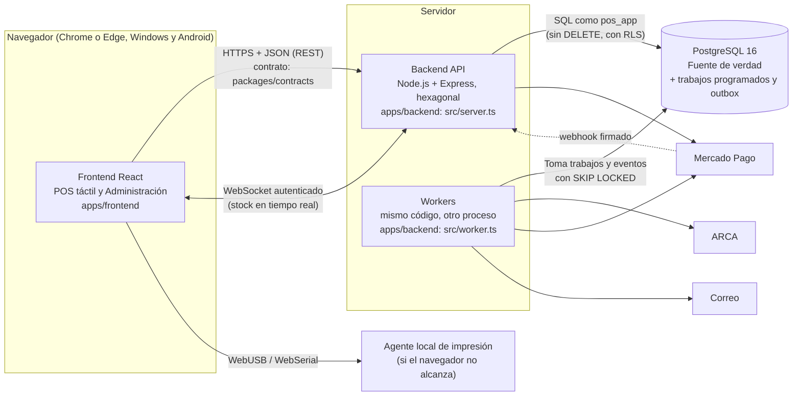

# Diagrama de contenedores

Las piezas que se despliegan y cómo se comunican. Deriva del [plan](../../sdd/plan.md) (§1.1) y de AD-01, AD-02, AD-06, AD-07 y AD-19.

## Reglas entre contenedores

| Regla                                                                                                                                                                            | Dónde se verifica                                     |
| :------------------------------------------------------------------------------------------------------------------------------------------------------------------------------- | :---------------------------------------------------- |
| El frontend habla con el backend **solo por endpoints**. Del resto del repositorio importa únicamente los tipos de `packages/contracts` (Const. 15).                             | `npm run lint:arch` (regla `frontend-solo-contratos`) |
| El contrato de la API es `packages/contracts/openapi.yaml`, escrito antes de cada endpoint. Las respuestas se validan contra él en las pruebas (AD-21).                          | Pruebas con `expectToMatchContract`                   |
| Toda comunicación es por HTTPS (Const. 17).                                                                                                                                      | El backend y Vite solo sirven HTTPS                   |
| La aplicación se conecta a PostgreSQL como `pos_app`: no es dueño, no puede borrar y no se saltea la seguridad a nivel de fila. Las migraciones usan `pos_owner` (AD-03, AD-18). | Pruebas de integración de privilegios                 |
| Los efectos posteriores a una transacción (comprobantes fiscales, eventos de tiempo real) salen del outbox, escrito en la misma transacción (AD-07).                             | Pruebas del outbox                                    |
| Los trabajos en segundo plano viven en PostgreSQL y se toman con `FOR UPDATE SKIP LOCKED`: nunca se ejecutan dos veces a la vez (AD-19).                                         | Pruebas de trabajos programados                       |
