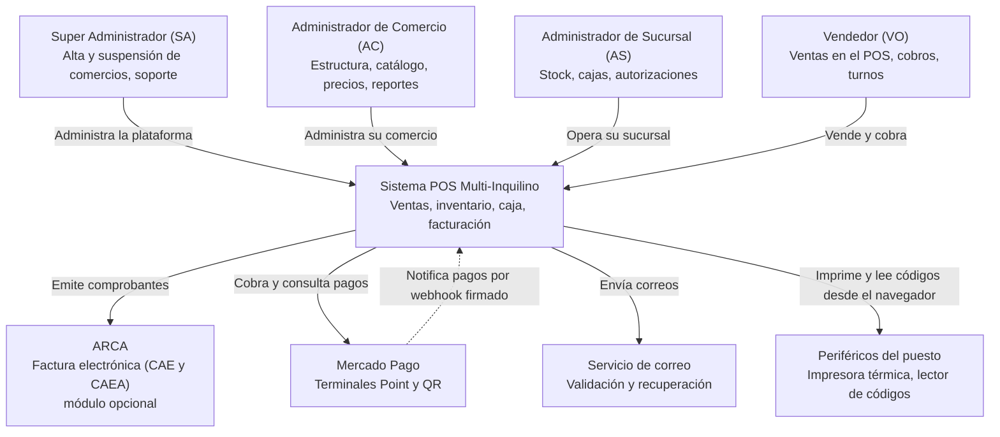

# Diagrama de contexto

Quién usa el sistema y con qué sistemas externos se comunica. Deriva del [spec](../../sdd/spec.md) (§2, actores) y del [plan](../../sdd/plan.md) (§1).

## Límites

- **Aislamiento:** cada comercio ve solo sus datos. El SA administra la plataforma pero no accede a datos comerciales (Const. 3 y 4).
- **Integraciones:** ARCA y Mercado Pago quedan detrás de puertos explícitos. Sus fallas nunca hacen figurar una venta como exitosa (Const. 11). Las notificaciones de Mercado Pago nunca se toman como verdaderas: solo disparan una consulta a su API (AD-24).
- **Periféricos:** están conectados al equipo del vendedor, así que los maneja el frontend (AD-16).
- **Fuera de alcance:** fidelización de clientes, e-commerce y conversión multimoneda (Const. 12).
